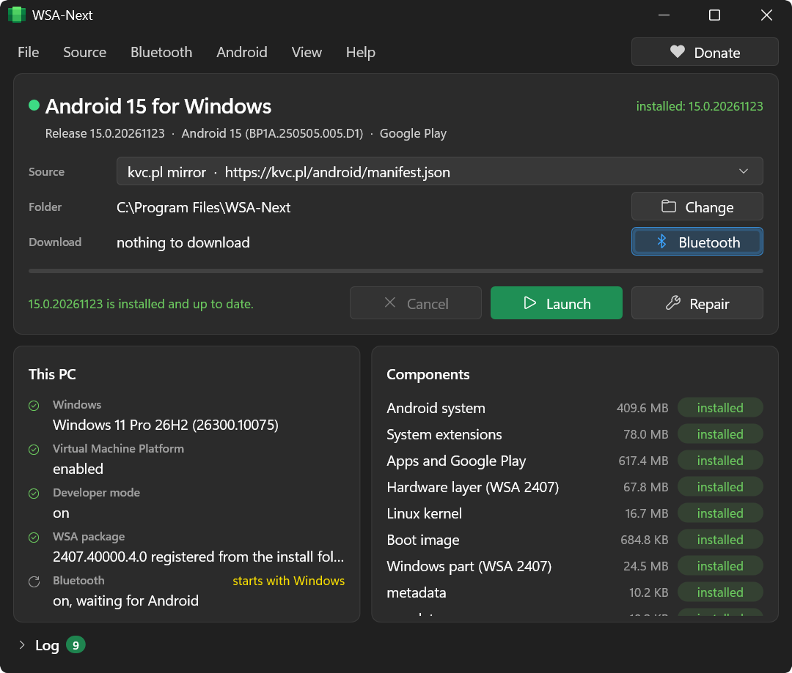
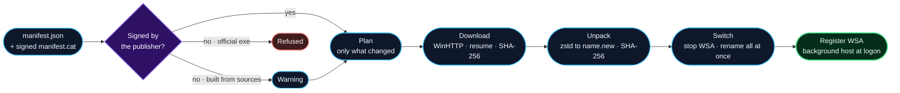
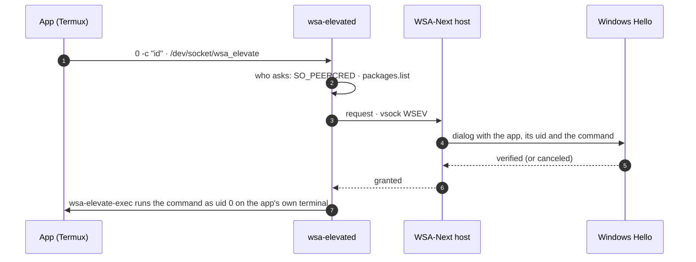
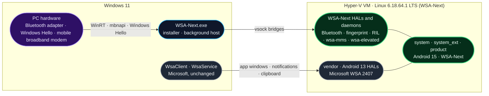
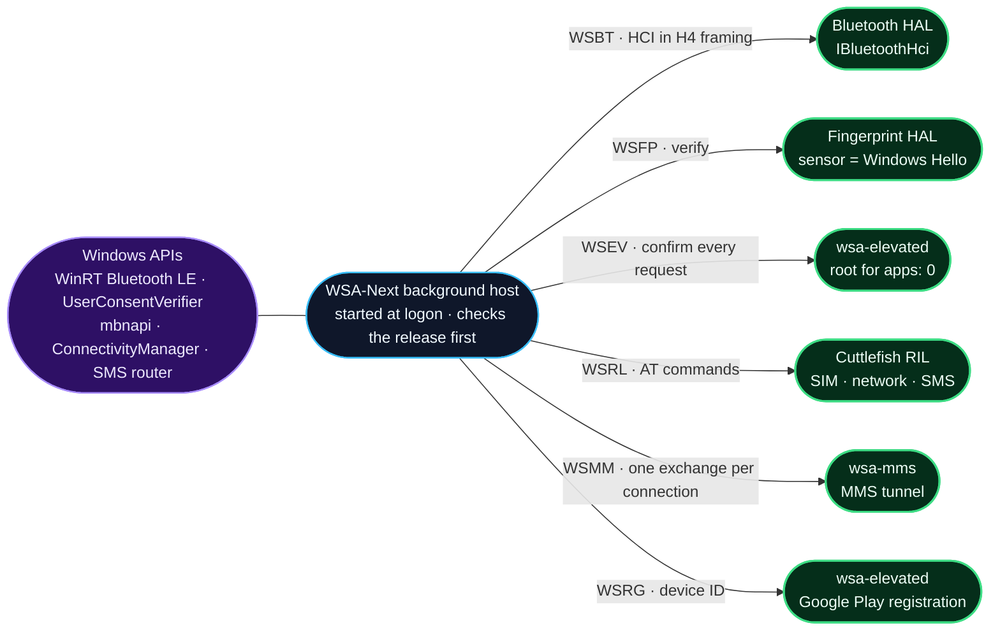
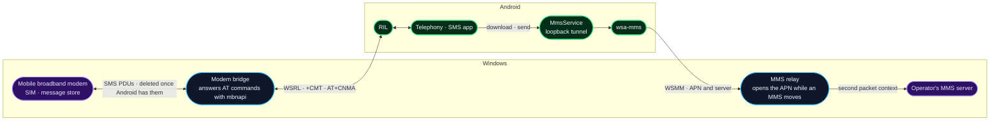

# WSA-Next

<div align="center">

[](https://www.youtube.com/watch?v=DkJuwOoKdv4)

*▶ Click above to watch the full install, Google Play, ARM64 and uninstall demo on YouTube (3 min 20 s, 1080p)*

<br><br>



</div>

Android 15 for the **Windows Subsystem for Android 2407** host, built from AOSP source
(`android-15.0.0_r36`, build `BP1A.250505.005.D1`).

Microsoft ended WSA with Android 13 (`2407.40000.4.0`). The Windows side of WSA
(`WsaClient`, `WsaService`, the Hyper-V VM and the vendor partition with the
Windows HALs) still works on current Windows 11, so the Android side can move on by
itself. WSA-Next replaces the Android **system**, **system_ext**, **product** images
and the **Linux 6.18.64.1 LTS kernel** (built from Microsoft's `linux-msft-wsl-6.18.y`
baseline with Android 15 ACK ports), while keeping Microsoft's Windows host and vendor partition.

**Download:** `WSA-Next.msi` (installer) or `WSA-Next.zip` (portable) from the [latest release](https://github.com/wesmar/wsa-next/releases/latest).

## Quick start

New to WSA? These are the steps and the commands, as they are typed. Run `WSA-Next.msi` (or
unpack `WSA-Next.zip`); it installs `WSA-Next.exe` and its 20 language files into
`C:\Program Files\WSA-Next`, and `WSA-Next.exe` fetches the Android 15 images on its own.

**1. Install.** Run `WSA-Next.msi`, then press **Install** in WSA-Next. Windows asks for administrator rights;
WSA-Next may ask to turn on developer mode and the Virtual Machine Platform (then Windows
restarts once). When it is done, Android apps open as normal Windows windows.

**The first start takes a few minutes - that is normal.** Android sets itself up the way a new
phone does: it prepares every preinstalled app and its user data, so the fans may spin for a
while. In the WSA settings, **Apps** shows "0 apps found" until Android has started, and the
apps then appear one by one (YouTube, the largest, comes last) - in the list and in the Start
menu. Later starts take seconds.

**Register the PC with Google once.** For Google, a new WSA-Next installation is a new device
that is not certified, and Google Play works fully only after the device is registered. WSA-Next
makes that a 30-second job: as soon as Play services have the device's ID, WSA-Next shows the
Windows notification **"Register this PC with Google Play"**. Click it: the ID goes to the
Windows clipboard and <https://www.google.com/android/uncertified> opens in your Windows
browser. Sign in with your Google account, paste the ID, press **Register**. The notification
comes back after every start until you have clicked it. The same is always at hand: the
**Register…** button in the window's **This PC** card (row **Google Play**), **Android › Register
with Google Play…**, the menu of WSA-Next's notification-area icon, or
`WSA-Next.exe register`. When Android has not handed the ID over yet, WSA-Next starts it and
opens the page as soon as the ID arrives.


A few minutes later, open the Play Store and sign in (or create an account). Chrome, WebView
and the Play Store then update themselves to the current versions. Google may e-mail a
security alert about a sign-in on a new Android device, and a sign-in before the registration
may be refused as a possible risk: both are Google's usual reaction to a new device - register
first, then sign in again.

A new installation is a new device for Google; an update of WSA-Next keeps the registration.
The same registration fixes the Play Store screen "Updating Google Play for you - Google Play
will switch to the new language you chose - Couldn't finish the update": until Google knows the
device, the Play Store cannot download its language pack (any language other than English).
Without WSA-Next's window the ID can also be read with `adb` (turn on **Advanced settings ›
Developer mode** in the WSA settings; `adb` is in Google's SDK Platform-Tools):
`adb root`, then
`adb shell "grep -o 'android_id\">[0-9]*' /data/data/com.google.android.gms/shared_prefs/Checkin.xml"`.

**2. Check Windows Hello** (fingerprint, face or PIN - used for Android's fingerprint sensor and
for root). In a terminal:

```
"C:\Program Files\WSA-Next\WSA-Next.exe" hello --check     # is Windows Hello set up for me?
"C:\Program Files\WSA-Next\WSA-Next.exe" hello --test      # show the Windows Hello dialog now
```

If `--check` says it is not set up: Windows **Settings › Accounts › Sign-in options**, add a PIN
(and a fingerprint or face, if your PC has a reader).

Apps that ask for your fingerprint often (a bank, a broker) can be let in without asking again
for a while after one confirmation: menu **Android › Remember Windows Hello** (5 or 30 minutes,
or until Windows is locked), or `WSA-Next.exe hello remember 5|30|lock --yes`. It is off by
default and at your own responsibility: whoever uses the unlocked PC meanwhile gets in too.
Locking Windows (Win+L), sleep with a sign-in and signing out always end it, and root for
Android apps (`0`) still asks every time.

**3. Bluetooth for Android** (optional): menu **Bluetooth › Start**. Android then sees your PC's
Bluetooth adapter: scan for a BLE device (a smart band, a sensor, a scale) from an Android app.

**4. Root for Android apps** (optional, off by default): menu **Android › Root for apps**, or

```
"C:\Program Files\WSA-Next\WSA-Next.exe" elevation on
```

Then, in Termux (or `adb shell`):

```
0                          # a root shell; exit with "exit"
0 -c "id"                  # one command as root: prints uid=0(root)
0 pm list packages -3      # the apps you installed, listed by root
0 cat /proc/meminfo        # any program with its arguments
```

Every time, Windows shows a Windows Hello dialog with the app and the command. Touch the
fingerprint reader (or type the PIN) and the command runs; cancel and it does not. Apps that
ask for root by themselves (file managers, AdAway) look for `su`: also turn on
**Android › su for root apps** (`elevation su on`).

Why `0` and not the usual `su`? Apps that refuse to run on rooted devices search for a file
named `su`; WSA-Next has none, so there is nothing to hide (see
[Why the command is `0`](#why-the-command-is-0-and-not-su)).

**5. Everyday things.** The WSA-Next icon in the notification area (next to the clock) shows
what runs and has the switches. **Android › Android settings…** (also in the icon's menu, as
**Android Settings** in the Start menu next to the Android apps, and `WSA-Next.exe settings`)
opens Android's own settings: networks and the SIM, apps, storage, display. **File › Stop WSA**
frees the memory Android uses; it starts again with the next Android app. **File › Uninstall**
removes WSA-Next and asks whether to keep your Android apps and data. When a newer Android
release or a newer WSA-Next is out, the icon gets a small orange dot; the window then offers
**Update** (Android) or **Update app** (WSA-Next itself, in a few seconds).

| Message | What it means |
|---|---|
| `0: root for Android apps is off` | turn it on in WSA-Next (step 4) |
| `0: Windows Hello is not set up on Windows` | set up a PIN or fingerprint (step 2) |
| `0: denied on Windows` | the Windows Hello dialog was canceled |
| `0: another request is waiting for Windows Hello` | answer the dialog that is open first |

## What works

Tested on a clean install (fresh userdata) with the WSA-Next Linux 6.18.64.1 LTS kernel,
the stock vendor partition, SELinux **enforcing** and no manual tweaks:

| Area | State |
|---|---|
| Boot, SELinux enforcing, Linux 6.18.64.1 LTS kernel (`linux-msft-wsl-6.18.y` + ACK ports) | works |
| Android apps as Windows windows (open, move, resize, close) | works: Windows animates opening, closing and minimizing as for its own windows, and an app that starts through a launcher trampoline (the Play Store) opens as one window, where it was last |
| Launching apps from Windows (`wsa://package`), Start menu shortcuts after install | works |
| APK install with Windows package verification | works |
| ARM apps: 32-bit through Intel Houdini (WSA's vendor partition); 64-bit through Houdini, or Google's `ndk_translation` in the Google Play variant | works |
| Current ARM64-only apps built on Chromium (Microsoft Edge 157, with its sandboxed renderers) | works in the Google Play variant |
| Notifications as Windows toasts | works |
| Clipboard Windows to Android | works |
| Windows user folder in Android (`/sdcard/Windows`, virtiofs) | works |
| Network (Ethernet with the host's Wi-Fi, metered and roaming state) | works |
| GPU: OpenGL ES 3.0 (Microsoft translator to Direct3D), Vulkan 1.1 (gfxstream / Dozen) | works |
| Hardware video decoding (H.264, HEVC, VP9, AV1 through the Windows host) | works |
| Audio output and input | works |
| Crash reports and ANR traces in WSA's Windows diagnostics folder | works |
| Google Play variant: Play services, Play Store, Chrome and Google WebView (x86 and x86_64), all kept current by Google Play; sign-in and new accounts; Google Password Manager for autofill and passkeys; font and emoji updates from Google | works |
| App data backup to the Google account | works (WSA 2407 had no backup service) |
| Bluetooth | in progress: the PC's adapter through `WSA-Next.exe` (**Bluetooth** menu): LE scanning, GATT (reads, writes, notifications, indications), pairing through Windows; classic Bluetooth (RFCOMM) not yet (WSA 2407 has no Bluetooth) |
| Fingerprint | Windows Hello (fingerprint, face or PIN) as Android's fingerprint sensor, class WEAK (WSA 2407 has none) |
| SIM, SMS and MMS | in testing: a PC with a mobile broadband modem gives Android its SIM, network, SMS and MMS (messages in Android's SMS app, such as Google Messages; codes read by apps that sign in with a phone number; pictures in and out through the operator's MMS access point, opened by Windows next to the PC's own connection). No calls and no mobile data in Android: the PC has its own network. Without a modem Android shows no SIM (WSA 2407 has no telephony) |
| Root for apps | `0` - root is uid 0 - confirmed on Windows with Windows Hello for every request, off by default; no Magisk, the images stay signed and unchanged |

WSA's Houdini (2023) cannot load many current ARM64-only apps (BTI/PAC code, 16 KB
pages, packed libraries such as Edge's `libmsaoaidsec.so`). The Google Play variant
therefore runs 64-bit ARM code through Google's `ndk_translation` (see
[ARM translation](#arm-translation)).

`android\tools\appcompat-test.ps1` starts every installed app in turn and reports whether it
runs, gets a Windows window, crashes, and which translator runs its native code.
Apps checked with it from Google Play, all without crashes: Chrome, YouTube (VP9 through
WSA's hardware decoder), Spotify, Discord, Gmail, Google Photos, ChatGPT, Allegro and
mBank (native x86_64), Google Authenticator (Java only) and Microsoft Edge (ARM64,
`ndk_translation`). Most current Play apps ship x86_64 code, so the translators matter
mainly for ARM-only apps and games.

## The installer (`WSA-Next.exe`)

`WSA-Next.exe` installs and updates WSA-Next: one native C++23 executable (no runtime, about
1.7 MB) with a Direct2D interface (Windows 11 dark theme, Mica, per-monitor DPI) and the same
functions on the command line. It reads a release **manifest**, downloads only the components
that changed, checks them, unpacks them and registers WSA with Windows.



| Step | What happens |
|---|---|
| Release | `manifest.json` from GitHub Releases, the kvc.pl mirror, a local test server or any URL (HTTPS; plain HTTP only for `localhost`) |
| Plan | each component (`system`, `system_ext`, `product`, `vendor`, kernel, initrd, the Windows part, the metadata and user data templates) is compared with `wsa-next.json` in the install folder; unchanged ones are not downloaded |
| Download | WinHTTP, resumed with HTTP range requests after an interruption or on the next start, up to five attempts, SHA-256 of every file |
| Unpack | one zstd stream per component (`--long=31`), every file to `<name>.new` next to the installed one, bounded by the size in the manifest and checked against its SHA-256 while it is written; the Windows part is a tar unpacked with checked paths (no `..`, drive letters or device names) |
| Switch | only when every component has unpacked: WSA is stopped and all `.new` files are renamed over the installed ones, so a failure or a cancellation leaves the previous release untouched and WSA keeps running while the new one unpacks |
| Windows | developer mode and Virtual Machine Platform when missing (after a question), the dependency packages (VCLibs, UI.Xaml), then the package is registered from the install folder in development mode; a new WSA gets developer mode off (as in the Microsoft Store version) and optional diagnostic data off - otherwise WSA waits at its first start for an answer to that question - and a choice made in WSA's settings is kept |

The package keeps Microsoft's identity (`MicrosoftCorporationII.WindowsSubsystemForAndroid_8wekyb3d8bbwe`):
`WsaClient` and `WsaService` depend on it for `wsa://` links, notifications, Start menu entries
of Android apps and the user data disk in the package's `LocalCache`. An existing WSA (from the
Microsoft Store or another unpacked build) is replaced and the Android apps and their data stay.
The install folder is `%ProgramFiles%\WSA-Next` unless another one is chosen.

Windows lets one user at a time register an unpacked package. When WSA is registered for
another Windows user of the PC, an installation from that user's install folder updates the
files for them (their registration and their background host's logon task stay as they are)
and says so; from another folder it stops before downloading anything, and while their WSA
runs it does not cut it off: they close it first.

```
WSA-Next.exe                         graphical interface (asks for administrator rights)
WSA-Next.exe status                  Windows, Virtual Machine Platform, developer mode, installed WSA
WSA-Next.exe check  [--source s]     what the release offers and what would be downloaded, and
                                     whether a newer WSA-Next is out
WSA-Next.exe install [--source s] [--dir folder] [--yes] [--files-only] [--keep-downloads]
WSA-Next.exe uninstall [--all] --yes remove WSA-Next (keeping the Android data, or everything)
WSA-Next.exe stop                    stop WSA and free its memory; nothing is removed
WSA-Next.exe verify [folder]         check that the installed Android is an official release, unchanged
WSA-Next.exe bluetooth               give Android the PC's Bluetooth adapter until Ctrl+C
WSA-Next.exe hello [--check|--test]  Windows Hello for Android (the bridge, or a check of this PC)
WSA-Next.exe hello remember [off|5|30|lock] [--yes]
                                     remember a Windows Hello confirmation for Android apps
WSA-Next.exe elevation [on|off]      root for Android apps, every request confirmed with Windows Hello
WSA-Next.exe launch                  start Android (opens the Play Store, or Android's Settings)
WSA-Next.exe settings                open Android's own settings (networks, the SIM, apps, storage)
WSA-Next.exe register                register this PC with Google Play: the device ID to the clipboard
                                     and Google's page in the browser (starts Android when needed)
WSA-Next.exe modem                   the PC's modem as Android sees it (SIM, network, stored messages)
WSA-Next.exe lng-export|lng-check    language files (see Languages)
```

**File › Stop WSA** (Ctrl+Shift+R, or `stop`) frees what WSA's virtual machine holds (memory,
CPU) without uninstalling anything: Android shuts down the way WSA's own settings do it, the end
of the VM arrives as a Host Compute Service notification, and a VM that has not ended after
30 seconds is terminated. WSA starts again with the next Android app.

The window is only for installing and settings; Bluetooth, Windows Hello and root for Android
live in the background host (`host --background`, started at logon), so closing the window
changes nothing. The host has an icon in the notification area (**Android › Icon in the
notification area**, on by default): its tooltip says whether Android runs, whether Bluetooth is
connected and whether root is on; its menu opens WSA-Next or Android's settings, switches
Bluetooth, root and su, stops WSA or the background services, and opens the log. Every root grant also shows as a
Windows notification, so none goes unseen, and so does the Google Play registration of a new
installation (with **Register with Google Play…** in the menu). The host keeps the device ID
Android hands it at every start, so the window's **Register…** button, the menu item and
`WSA-Next.exe register` (they signal the named event `Local\WSA-Next.Host.Register`) work at any
time. The icon follows the host's change notices (WSA's VM up or down, a bridge connected) and
never polls.

**Updates.** A newer Android release or a newer WSA-Next shows as a small orange dot on the icon,
with a line in its tooltip and its menu (which opens the window); there is no pop-up. The host
reads only the release manifest (about 14 KB with its catalog), at logon and when Windows reports
a change of the network (`NotifyNetworkConnectivityHintChange`), at most once in 20 hours and
only with Internet access; a failed read is silent and the next change of the network tries
again. There is no timer. The window reads the manifest whenever it refreshes and records what
it found for the icon. Nothing is downloaded without a click: a newer Android release through
**Update** as before, a newer WSA-Next through **Update app** (left of **Donate**, shown only
then) or **Help › Update WSA-Next…**. That downloads WSA-Next Setup into
`%ProgramFiles%\WSA-Next\.download` (only administrators write there), checks its size, SHA-256
and publisher signature while holding the file open, stops this session's background host and
runs Windows Installer (`/passive`); Setup replaces `WSA-Next.exe`, starts the host again, the
Setup file is deleted and WSA-Next opens again, in a few seconds. Each Setup is a full package
that replaces the previous one (no patches): Windows Installer keeps exactly one copy of it in
`C:\Windows\Installer`. Without Setup (`WSA-Next.zip`) the button opens the release page.
**Help › Check for updates automatically** turns the host's look off; `check` shows the same.

Pages the window or the host open (the releases, Google's registration page, **Donate**) open
through Explorer: the browser runs with the user's rights, not elevated like WSA-Next.

### Official builds and releases

An official `WSA-Next.exe` carries the publisher's Authenticode signature, and an official
release carries `manifest.cat` next to `manifest.json`: a catalog signed with the same
certificate that lists the manifest's SHA-256. The manifest in turn lists the SHA-256 of every
Android disk and boot file as installed.

| | Official `WSA-Next.exe` | Built from the sources |
|---|---|---|
| Installs | official releases only | any release, with a warning |
| Bluetooth, Windows Hello, root (`0`), SIM, SMS and MMS | served while the installed Android is an official release, unchanged | not available |

The background host checks the installed release when it starts: the signed manifest (kept in
the install folder as `release.json` and `release.cat`) and the digest of every disk. A digest
is remembered with the file's identity (volume, file ID, size, change time) in a machine-wide
registry key only administrators can write, so the disks are read only after they changed and
no ordinary process can vouch for a changed disk. The installer takes the digests while it
writes the disks, so the host's first check reads nothing again. A repackaged image (other branding, other files) is a different
image, and the bridges do not serve it. `status` shows the host's latest verdict.

The official catalog check pins Certum's root keys (the SHA-256 of their public keys), not only
their names, and holds the catalog open without write sharing while it is checked, so the bytes
whose signature was verified are the bytes whose members are read. The publisher signature is a
mark of origin and trust, not copy protection: anyone may build WSA-Next from these sources.

### Root for apps (`0`)

Root without Magisk and without changing a byte of the signed images. **Android › Root for apps**
(or `elevation on`) turns it on; it is off by default.

```
0                  an interactive root shell (Termux, adb shell)
0 -c "command"     the command through sh
0 program [args]   the program
```



| Step | Where | What happens |
|---|---|---|
| ask | the app | `/system_ext/bin/0` connects to `/dev/socket/wsa_elevate` |
| who | `wsa-elevated` | the kernel names the caller (`SO_PEERCRED`: uid, pid); `packages.list` names the app |
| decide | Windows | the elevation bridge of the background host (vsock port `WSEV`) shows Windows Hello with its own text: the app, its uid and the command, control and direction-changing characters removed |
| run | `wsa-elevate-exec` | started by the daemon only after a verified answer; its executable enters AOSP's root domain (`su`, debug builds), takes the caller's terminal or stdio from the caller itself (`pidfd_getfd`) and runs the command |
| relay | `0` | on a terminal the command gets a pty of its own (line editing, job control, Ctrl+C); the exit status comes back |
| again | `wsa-elevated` | a caller that is root in the elevated domain already (its context from `SO_PEERSEC`) is not asked again: it gains nothing |

#### Why the command is `0` and not `su`

For fifteen years, root on Android has meant one file: a binary called `su`. Root detection is
built around that name. Banking, payment, streaming and game apps (and libraries such as
RootBeer, or the checks inside anti-cheat and DRM SDKs) look for:

* a file named `su` in the usual places - `/system/bin/su`, `/system/xbin/su`, `/sbin/su`,
  `/su/bin/su`, `/data/local/xbin/su` - and in every folder on the `PATH`;
* whether `which su` or `Runtime.exec("su")` succeeds;
* the packages of root managers (Magisk, SuperSU, KingRoot) and a modified `/system`.

Because of that, rooting on phones turned into hide and seek: Magisk's DenyList, Zygisk modules
and per-app mount namespaces exist mostly to make the word `su` disappear again for the apps
that look for it - a cat-and-mouse game that breaks with every update of the detectors.

WSA-Next does not play that game; it does not need to:

* **There is no `su` file.** Root is user ID 0, so the command is `0`. A file named `0` is in no
  detector's list, and it is not hidden either: it is a normal, documented system binary.
* **Even AOSP's own `su` is gone.** Debug builds of Android ship `/system/xbin/su` (usable from
  `adb shell` only). Our `0` module declares `overrides: ["su"]`, so the build leaves that file
  out of the image: nothing named `su` is anywhere on the system.
* **The decision is not inside Android.** The switch that allows root and the confirmation of
  every request are on Windows, behind Windows Hello. There is no root manager app to detect.
* **Nothing is modified.** The images are the signed, official ones; SELinux stays enforcing.

So the clean state needs no hiding at all, and scripts written for `su -c "..."` work with
`0 -c "..."`. Only if you want apps that insist on the name `su` (below) does the name appear -
and then because you chose it, visibly, with one switch you can turn off again.

Apps that ask for root themselves (file managers, AdAway, anything built on libsu) look for `su`
and cannot be taught a new name. For them there is **Android › su for root apps** (`elevation su
on`), off by default: the init script puts an empty `/dev/wsa/bin` last on every process's
`PATH`, and while the switch is on and the bridge is connected, the daemon places the link
`su -> /system_ext/bin/0` there. `0` called as `su` speaks su's syntax (`-c`, `-`, `--login`,
`--mount-master`, `-v`, `su 0 command`), so those apps work unchanged, and Windows Hello still
confirms every request. `/dev` is one tmpfs for every process: the link appears and disappears
for all apps at once, without touching `/system`. While it is on, other apps' root checks see
`su` too - that is the honest price of the name.

**Security notes.** The daemon itself runs in a narrow SELinux domain and never receives an app's
file descriptors. Every request and answer is written to the bridge log
(`%LOCALAPPDATA%\WSA-Next\bluetooth.log`) and to logcat (`wsa-elevated`), and every grant shows
as a Windows notification. A request is a decision about the app: confirm only apps you trust.
The dynamic linker drops `LD_PRELOAD` and similar variables on the way into the root domain.

### Uninstalling

**File › Uninstall…** (or `uninstall`) offers two ways:

| | Keep Android data | Remove everything (`--all`) |
|---|---|---|
| WSA package registration | removed | removed |
| Install folder | only what the installer wrote there (`wsa-next.json` lists it), then the folder if empty | same |
| Android data disk (apps, accounts, files) in `%LOCALAPPDATA%\Packages\…` | **kept**, used again by the next installation | deleted |
| Start menu entries, "Installed apps" entries, file and link associations of Android apps | removed by WSA with its package, created again by the next installation | removed, including what an earlier removal left behind |
| WSA-Next's Start menu entry **Android Settings** (WsaClient lists Android's Settings nowhere) | removed | removed |
| Notification settings, tiles, privacy consent, Windows caches of the package and the install folder | kept | removed |
| WSA-Next settings (`HKCU\Software\KVC\WSA-Next`) and the host's digest cache (`HKLM\Software\KVC\WSA-Next\Digests`) | kept | removed |
| Background host with the Bluetooth and Windows Hello bridges | stopped, no longer starts with Windows, its copy in `%ProgramFiles%\WSA-Next` removed | same, and also the Hyper-V socket service registrations of test builds and the log |
| Developer mode, Virtual Machine Platform | unchanged | turned off again **only if WSA-Next turned them on**, and not while other unpacked apps or WSL distributions need them |

A WSA registered from somewhere else (the Microsoft Store, another unpacked build) is never
removed, and neither are its data and entries. "Remove everything" also cleans up after a WSA
that was removed through Windows Settings. Windows' own usage history (jump lists, the app list
backup, CloudStore) is not edited.

### Languages

The interface is available in 21 languages. English is built into the executable and always
works; every other language is a `language\<code>.lng` file next to it (`bin\language`, sources in
`src\resources\language`). A missing or broken string falls back to English one by one, so a
partial file still works. The command line stays English so that scripts can parse its output.

| Code | Language | Code | Language | Code | Language |
|---|---|---|---|---|---|
| `en` | English (built in) | `hi` | हिन्दी (Hindi) | `ru` | Русский (Russian) |
| `ar` | العربية (Arabic) | `id` | Bahasa Indonesia | `tr` | Türkçe (Turkish) |
| `cs` | Čeština (Czech) | `it` | Italiano (Italian) | `uk` | Українська (Ukrainian) |
| `de` | Deutsch (German) | `ja` | 日本語 (Japanese) | `vi` | Tiếng Việt (Vietnamese) |
| `es` | Español (Spanish) | `ko` | 한국어 (Korean) | `zh-cn` | 简体中文 (Simplified Chinese) |
| `fa` | فارسی (Persian) | `nl` | Nederlands (Dutch) | `zh-tw` | 繁體中文 (Traditional Chinese) |
| `fr` | Français (French) | `pl` | Polski (Polish) | | |
| | | `pt` | Português (Portuguese, Brazilian wording; also used for `pt-PT`) | | |

The language is chosen automatically from the Windows display languages in their order of
preference: first a file that lists the language in its `#locale=` header, then one named after it
(`pt-br.lng`, `pt.lng`, `por.lng`). Nothing matches: English. **View > Language** switches it by
hand and shows each language in its own name with its coverage, so an unfinished translation is
visible. `zh-cn` also serves `zh-Hans`/`zh-SG` and `zh-tw` serves `zh-Hant`/`zh-HK`/`zh-MO`.

Except for Polish, the translations were produced without a native-speaker review; corrections
are welcome, in particular for Arabic, Persian, Hindi and the two Chinese variants.

Adding or improving a language:

1. `WSA-Next.exe lng-export xx.lng` writes the English template (`ID=text`, UTF-8, escapes `\n`,
   `\r`, `\t`, `\\`). Translate the text after `=`, set `#name=` (the language's own name) and
   `#locale=` (the Windows languages it covers).
2. Keep every `{}` / `{0}` placeholder. Automatic `{}` fields keep their order (they may be left
   out, never added or reordered; rephrase the sentence instead); numbered `{0}`, `{1}` may move.
3. Save it as `src\resources\language\xx.lng` and add it to `WSA-Next.vcxproj` and
   `WSA-Next.vcxproj.filters` (one `CopyFileToFolders` entry in each, like the others), so that the
   build copies it to `bin\language`.
4. `WSA-Next.exe lng-check language\xx.lng` reports missing strings and broken placeholders
   (without a file name it checks every file in `language\`).

Installing and uninstalling WSA-Next copy and remove the `.lng` files together with the
background host.

### Building and releasing

Build: `build.ps1` (PowerShell 7) finds the newest Visual Studio with the C++ tools and the newest
complete Windows SDK by looking at the files on disk (`vswhere` and a folder scan, no version
numbers in the scripts), builds with `/W4 /WX /sdl /guard:cf`, CET and `/Brepro`, and writes
`bin\build-receipt.json` with the toolchain and the hashes of every input and output.

Release: `android/tools/package-release.sh` compresses the components and writes the manifest
with the digests of the packed and the unpacked files (an unchanged component keeps its file, so
an update only adds what changed). The vendor image as the WSA tools unpack it carries
`init.windows_x86_64.rc.backup` next to the patched `init.windows_x86_64.rc`, and init parsed it
as a second script (Microsoft's early-init and fs actions ran twice); the script removes it with
`debugfs` and keeps the cleaned image per input digest, so the vendor disk of a release changes
only when Microsoft's does. The publisher then adds WSA-Next Setup to the release: the signed
`WSA-Next.msi` next to the manifest and an `app` entry in it (`version`, `url`, `size`,
`sha256`, and optionally `minimum`, the oldest `WSA-Next.exe` that may install the release),
which versions that do not know it read past. Then the manifest is signed (a catalog made with
`New-FileCatalog` and signed with the code signing certificate). A web server must serve `.zst`
and `.cat` files (IIS: a `mimeMap` for each in `web.config`) and answer range requests. Served on
the same computer as `/wsa-next`, the release is the source **local**
(`http://localhost/wsa-next/manifest.json`); an official WSA-Next.exe installs it only when it
carries the publisher's signature.

## How it fits together



The background host connects to Android over Hyper-V sockets (vsock in the guest); each HAL or
daemon listens on its own port, and the host connects as soon as WSA's VM is up:



The disks, as WSA's VM sees them:

```
Windows 11
  WsaClient / WsaService (Microsoft, unchanged)
  Hyper-V VM
    kernel 6.18.64.1+ (WSA-Next, from linux-msft-wsl-6.18.y + ACK ports)
    initrd: wsainit (Microsoft, WSL-derived init)
    SCSI 0:0:0:0  system.vhdx      <- WSA-Next (root filesystem, system-as-root)
    SCSI 0:0:0:1  vendor.vhdx      <- Microsoft WSA 2407 (Android 13 vendor, VNDK 33)
    SCSI 0:0:0:2  system_ext.vhdx  <- WSA-Next
    SCSI 0:0:0:3  product.vhdx     <- WSA-Next
    SCSI 0:0:0:4  userdata         (created by WsaService)
    SCSI 0:0:0:5  metadata         (created by WsaService)
    virtiofs: shared_mem, shared_tmp, /data/anr, /data/tombstones, Windows user folder
```

Boot sequence: `wsainit` mounts only the system disk and starts `/init` from it.
Android's first-stage init then reads `/system/etc/fstab.${androidboot.fstab_suffix}`
(`2.windows` on WSA 2407) and mounts vendor, system_ext, product and metadata by SCSI
address. Second-stage init compiles the split SELinux policy (Android 15 platform policy
plus the Android 13 vendor policy, sepolicy version 33.0).

Microsoft's integration with Android is modular, which is what makes the port practical:

| Piece | Mechanism |
|---|---|
| system_server services | `config_deviceSpecificSystemServices`, `config_deviceSpecificDisplayAreaPolicyProvider`, a `LaunchParamsModifier` |
| SystemUI | a SystemUI variant on `SystemUI-core` (same pattern as TvSystemUI) with its own WM Shell module; it mirrors every freeform task into a Windows window |
| Host channels | privileged apps (SystemApp, UserApp, HomeApp) talking to Windows over the vendor's remote connection manager (`rcmsvc`, vsock, protobuf) |
| Composition | SurfaceFlinger tags layers with the task id, the vendor's HWC composes each task into its own Windows window |

A static scan of the Android 13 framework found no Microsoft hooks inside `framework.jar`
or `services.jar`.

## What is in this repository

```
src/                          WSA-Next.exe, the Windows installer (C++23, see below)
  resources/language/         translations (*.lng); the build copies them to bin\language
build.ps1                     builds WSA-Next.exe (/W4 /WX /sdl /guard:cf, CET, /Brepro)
build_msi.ps1                 builds WSA-Next.msi (20-language Setup Wizard) and WSA-Next.zip
installer/msi-strings.json    localized strings for the 20-language Windows Installer wizard
third_party/zstd/             zstd decoder (BSD), from AOSP's external/zstd
android/                      everything that builds the Android images
  device/wsa/wsa_x86_64/      device configuration
    wsa_x86_64.mk             product: generic system + WSA app set, separate system_ext/product
    wsa_x86_64_gapps.mk       same with Google Mobile Services, the Google apps of a stock
                              phone and Google's ARM64 translator (vendor/gapps,
                              vendor/google_apps, vendor/ndk_translation, not included)
    BoardConfig.mk            x86_64 + x86, ext4 images, no kernel/boot/vendor build
    fstab.1.windows/.2.windows  first-stage mount tables (WSA's disk layout)
    houdini/                  /system paths expected by the vendor's Houdini setup
    ndk_translation/          binfmt_misc registration for Google's ARM64 translator
    bluetooth/                Bluetooth HAL on vsock (the PC's adapter through WSA-Next.exe)
    fingerprint/              fingerprint HAL whose sensor is Windows Hello
    elevate/                  root for apps: 0, wsa-elevated, wsa-elevate-exec
    telephony/                the RIL's init script and features, the wsa-mms daemon (MMS)
    registration/             Google Play variant: offers "Register this PC with Google Play"
                              (shown by WSA-Next on Windows)
    gms/                      default permissions of the Google Play variant
    init/                     device-wide init actions (init.wsa-next.rc)
    rro/                      resource overlays (framework, DocumentsUI, NetworkStack,
                              settings, Google WebView)
    sepolicy/                 SELinux policy of the HALs and daemons above and of the patched
                              vold property
  patches/<aosp project>/     source patches, applied by tools/build.sh
  tools/
    build.sh                  sync into AOSP, apply patches, lunch, build, convert to VHDX
    fetch_gms.sh              prepare vendor/gapps, vendor/google_apps and vendor/ndk_translation
                              (Google Play variant)
    collect-play-apps.ps1     take this month's Google apps from a Play-updated installation
    integrate-play-apps.sh    check them and generate vendor/google_apps/play for the image
    locales/SetLocales.java   list every language on the device (Play then adds all language splits)
    deploy-test.ps1           install images into a registered WSA 2407 and test the boot
    appcompat-test.ps1        start every installed app and report how it runs
    extract_images.sh         unpack WSA and AOSP GSI images into file trees
    make_stock_initrd.sh      build an initrd that only contains Microsoft's wsainit
    package-release.sh        compress release components with zstd and generate manifest.json
    dexmodel.py / dexcompat.py  DEX reader and Android 13 -> 15 API compatibility scanner
    split_ms_classes.py       split host-integration classes into reusable / to-port sets
  reports/                    scanner output (generated locally, not committed)
```

The device configuration also pulls in an optional `vendor/wsa` integration layer when
it is present. That layer contains Microsoft's apps and libraries and code derived from
them (see below), so it is **not** part of this repository. Without it the tree builds
plain Android 15 images. Google's apps are not included either.

## AOSP patches

Every change to AOSP is a small patch in `android/patches/`, written for WSA and kept generic
where possible.

| Patch | Why |
|---|---|
| `system/core` 0001 fs_mgr: resolve SCSI addresses | WSA's fstab names disks as `SCSI=h:c:t:l`; Microsoft's Android 13 fs_mgr resolved them through `/sys/bus/scsi/devices`. Needed for /vendor, /data and /metadata. |
| `system/core` 0002 tombstoned: named temporary files | `/data/tombstones` is a virtiofs share without `O_TMPFILE`; Android 15 tombstoned aborted on every crash, so no crash report reached Windows. |
| `frameworks/native` 0001 SurfaceFlinger: WSA layer metadata | Sends `com.microsoft.wsa.{taskid,windowtype,secure}` generic layer metadata to the WSA composer (HIDL composer 2.4); the task id is inherited down the layer tree, as Microsoft's Android 13 SurfaceFlinger did. |
| `frameworks/native` 0002 SurfaceFlinger: no present fences without a sync framework | WSA declares `ro.surface_flinger.running_without_sync_framework=true`: its composer returns no present fences. Android 15 decides whether present fences are reliable from a composer capability only, so every frame logged `trackPendingFrame: Invalid present fence` (about 60 lines a second) and apps were told display present times exist. Without a sync framework they are now treated as unreliable, as older SurfaceFlinger versions (`DispSync`) did. |
| `frameworks/base` 0001 StorageManager: no project quota on virtiofs | Quota ioctls fail on the Windows folder share. |
| `frameworks/base` 0002 WM Shell: PiP menu on any display | WSA's shell attaches the PiP menu as a shell-root window tagged with the task id and moves it between displays. |
| `frameworks/base` 0003 PackageManager: always send the APK list to verifiers | Android 14 sends `EXTRA_VERIFICATION_ROOT_HASH` only for incremental installs; WSA's verifier (Windows-side package scanning) needs it for every install, otherwise all installs fail. |
| `system/vold` 0001 signal emulated storage | Sets `external_storage.emulated_0.mounted`, which the Windows folder sharing waits for. |
| `system/linkerconfig` 0001 vendor native bridge | Houdini lives in /vendor and is reached through a /system symlink; Android 15's isolated system namespace rejected it silently, so ARM apps failed with `EM_AARCH64 instead of EM_X86_64`. /vendor is permitted only when a native bridge is configured. |
| `packages/modules/Connectivity` 0001 Ethernet capabilities on PC devices | WSA mirrors the host network into eth0 (Wi-Fi transport for app compatibility, metered, roaming). Android 14 limited this to automotive devices and a single transport. Restored for `FEATURE_PC` devices. |
| `art` 0001 settle the JNI id type in translated child zygotes | A child zygote (an app's app zygote) returned from post-fork setup before choosing its final JNI id type, so it preloaded guest libraries with one JNI function table and its children switched to another one that the native bridge had never made callable from guest code. Chromium's sandboxed renderers crashed on their first JNI call. |
| `art` 0002 nativeloader: an app on a system partition loads its own libraries | A class loader an app makes itself gets an isolated linker namespace that may load anything under `/data` and `/mnt/expand` (AOSP's workaround for apps that call `System.load()` with absolute paths). An app on a system partition keeps its libraries in its folder there: Chrome, which makes the class loaders of its isolated splits itself, crashed at start when integrated into `/product` (`libelements.so ... is not accessible for the namespace`) although its base loaded `libchrome.so` from the same APK. Such a namespace now also permits the folder of the calling APK when that is an app folder on a system partition - the app's own files and nothing else. |
| `frameworks/base` 0004 zygote: no seccomp for native bridge code | Guest code cannot install working seccomp filters: they check the guest architecture and system call numbers while the kernel sees the host's calls, so the first call after installation killed the process (Chromium's renderer sandbox, `SIGSYS`). In processes that run through a native bridge, `seccomp(2)` and `prctl(PR_SET_SECCOMP)` now fail as on a kernel without seccomp, after Android's own filters are in place. |
| `system/sepolicy` 0001 hal_bluetooth: hardware rules for non-coredomain HALs only | WSA-Next's Bluetooth HAL is a platform (coredomain) process that bridges HCI over vsock and touches no sysfs, rfkill, uhid, UART or vendor property. Those rules are scoped to `{ hal_bluetooth -coredomain }`, so the HAL passes the coredomain neverallows without loosening them. |
| `system/sepolicy` 0002 hal_telephony: hardware rules for non-coredomain HALs only | The same for the RIL, whose modem is reached over vsock: no radio or tty devices, EFS, sysfs or vendor shell. |
| `hardware/ril` 0001 librilutils: platform build | Built for system_ext: the RIL is a platform HAL. |
| `hardware/interfaces` 0001 radio compat: platform build | Built for system_ext and installed in `/system_ext/lib64`: the platform linker namespace does not search a `hw` folder. |
| `device/google/cuttlefish` 0001 RIL: platform build listening for the host modem | Cuttlefish's AT-command RIL runs as a system_ext HAL and listens on vsock (`-L`) for the modem bridge on Windows; base64 from BoringSSL; 64-bit only. |
| `device/google/cuttlefish` 0002 RIL: refuse data calls without retries | There is no mobile data in WSA. A failed data call reached Android as "retry at once", and with an APN list it retried every few milliseconds until the network stack ran out of receivers and system_server restarted. The RIL now answers with a permanent "service option not supported". |
| `device/google/cuttlefish` 0003 rild: explicit library without modem simulator ports | rild skipped loading the RIL when Cuttlefish's `ro.boot.modem_simulator_ports` was unset, which WSA does not set; it now loads the library given with `-l`, and copies the library's arguments without writing past the end of `argv`. |
| `packages/services/Mms` 0001 MmsService: MMS through the WSA-Next host | Android has no cellular network in WSA, so MMS could not be downloaded or sent. With the `wsa-mms` daemon present, each HTTP exchange goes through a loopback tunnel to it, and WSA-Next on Windows opens the operator's MMS access point on the modem and connects. The "MMS data enabled" check is skipped (Android has no mobile data setting there). |
| `packages/providers/TelephonyProvider` 0001 reload APNs when the build fingerprint changes | TelephonyProvider reloads `apns-conf.xml` only when `ro.build.id` changes, which WSA-Next releases of one Android version keep; an update never brought the APN list (and so MMS) to existing user data. |
| `frameworks/base` 0005 input: no layout notification for built-in keyboards | WSA's keyboard is built in, and Windows applies the user's layout before Android sees a key, so Polish, German or other letters arrive right with Android's default layout. Android 15 still posted "Keyboard layout set to English (US). Tap to change" as a Windows notification after every start, and changing the layout there would translate the keys twice. External keyboards (USB, Bluetooth) still get the notification. |
| `frameworks/base` 0006 WM: an app's window place is remembered for its launcher trampoline | Many apps start from a trampoline that starts the real activity in a new task and finishes (the Play Store's AssetBrowserActivity). Its splash screen makes it a Windows window for a moment; WSA's launch params modifier opens the real activity exactly there. When the app's window is saved (moved, closed), its place is now remembered for the trampoline too, so the next start opens both where the user left the app instead of a window that appears in one place and the app in another. |

## Device configuration notes

* `fstab.{1,2}.windows` are installed to `/system/etc`: WSA has no boot ramdisk, so
  first-stage init can only find the mount table in the system image.
* `WsaFrameworkOverlay` sets `config_disableLockscreenByDefault`. WSA 2407 disabled the
  lock screen through SettingsProvider; Android 14+ reads LockSettings, and a showing
  keyguard holds a sleep token that keeps every activity invisible.
* App data backup, which WSA 2407 did not have: the device declares
  `android.software.backup` and `WsaSettingsProviderOverlay` turns backup on by default
  (to the Google account on the Google Play variant).
* Consent defaults (set once at first boot, later user choices are kept): Play Protect
  scanning on and consented, backup on; sending unknown apps to Google and background
  Wi-Fi / Bluetooth scanning off. Location follows the Windows setting.
* adb asks before it lets a computer in (`ro.adb.secure=1`, Android's "Allow debugging?"
  dialog), as on a user build. It matters more here than on a phone: Microsoft's vendor init
  starts adbd on every debuggable build regardless of WSA's developer mode, WsaClient forwards
  port 58526 on all addresses, and Microsoft's package opens that port to the private network.
  Without the confirmation any computer on a home network had a root shell (`adb root`).
* Debuggable builds start a shell on the serial console, and Android then posts "Serial
  console enabled - performance is impacted", which WSA shows as a Windows notification after
  every start. `init/init.wsa-next.rc` stops that shell; adb and `0` are the ways in.
* Google Play variant: `registration/` (`WsaNextRegistration`) waits for Play services to
  check in with Google (`CHECKIN_COMPLETE`) and offers the registration. A click on an Android
  notification does not come back to Android on WSA for an app without a launcher activity
  (WSA forwards the notification to Windows, but no click event reaches Android, for any of its
  buttons), so the notice is Windows' own: the app asks `wsa-elevated` ("RGWN"), which reads the
  ID and hands it to WSA-Next's host over vsock port `0x57535247` ("WSRG", connected whenever
  the host runs, root for apps on or off). The host's notification-area icon shows the
  notification; a click (or the icon's menu item) copies the ID to the clipboard and opens
  Google's page through Explorer, so the browser does not run elevated like the host. The host
  then remembers a digest of the ID (not the ID) and answers later offers of it with "done".
  Without the host or its icon, the app posts its own notification with the ID (**Copy ID**,
  **Open page**, **Done**), which at least shows it. A new installation gets a new ID. Play
  services up to 25.x give the device ID to any app holding `READ_GSERVICES`; from 26.x on
  their provider gives it only to Google-signed apps (`GoogleSignatureVerifier`, logged as "is
  not approved to access the device ID"). The app then asks `wsa-elevated`, which answers this
  one package only (the uid comes from the kernel) with the number read from Play services'
  `Checkin.xml` by `wsa-elevate-exec --gsf-id` - no shell, no Windows Hello, nothing else read.
  Play services announce the check-in before their preferences reach the disk, so the reader
  waits for `Checkin.xml` to be written (inotify, at most 20 seconds) when the ID is not there
  yet.
* The vendor partition links against VNDK 33, so the build ships the v33 VNDK snapshot
  (`PRODUCT_EXTRA_VNDK_VERSIONS := 33`), like Android's GSI.
* Runtime properties match WSA 2407: no RescueParty, no predictive back, FUSE
  passthrough for emulated storage.

SIM, SMS and MMS in short (the details follow):



* Telephony: `telephony/` runs Cuttlefish's AT-command RIL (`libcuttlefish-rild` with
  `libcuttlefish-ril-2`) as a platform HAL in system_ext. The patches in
  `patches/device/google/cuttlefish`, `hardware/ril` and `hardware/interfaces` build it, libril and
  the radio compat library for system_ext, give the RIL `-L <vsock port>` (listen; Cuttlefish
  connects to its host instead) and replace libcuttlefish_utils' base64 with BoringSSL's;
  `patches/system/sepolicy/0002` scopes hal_telephony's hardware rules to non-coredomain HALs,
  as for Bluetooth. The RIL listens on vsock port `0x5753524C` ("WSRL"); the modem bridge in
  `WSA-Next.exe` (`src/telephony`) connects when the PC has a mobile broadband modem and plays
  the modem: it answers the AT commands with the Windows mobile broadband API (`mbnapi.h`: SIM,
  registration, signal, service centre, SMS in PDU form). The SIM files Android reads through
  `AT+CRSM` come from a small USIM table (the layouts of Cuttlefish's test card with the real
  ICCID and MNC length); Windows gives no raw access to the card. Features:
  `android.hardware.telephony` with `.gsm`, `.messaging`, `.subscription` and `.radio.access` -
  not `.calling` or `.data` (`config_voice_capable` is false): a laptop's modem has no voice path
  and the PC has its own network. A message Android has acknowledged is deleted from the modem's
  store (20 messages on the test modem), as a phone does with its SIM. So whatever is still in
  the store is not in Android yet: messages that came while Android was off go to it when its
  telephony starts, read or not (Windows marks a message read as it arrives when nothing takes
  it). The sign that Android listens is its first `AT+CIMI` (asked only by Android's telephony,
  after its handlers are registered) or `AT+CNMI`; the RIL sends the latter only from
  `onSIMReady`, which a reconnect can skip. `WSA-Next.exe modem` shows what Android will see,
  including the stored messages (index, status, time stamp, kind such as text, MMS notice or
  part i/n; no sender, no text).
* MMS: Android has no mobile data, so MmsService
  (`patches/packages/services/Mms`) asks for no cellular network when `/dev/socket/wsa_mms`
  exists. Each HTTP exchange goes through a loopback tunnel to the `wsa-mms` daemon
  (`telephony/wsa-mms.cpp`), which joins it with the connection the host keeps on vsock port
  `0x57534D4D` ("WSMM"). The tunnel's first line names the APN (from AOSP's
  `apns-full-conf.xml`, installed as `/product/etc/apns-conf.xml`) and the server: the APN's MMS
  proxy, or the MMS server itself. The host opens that APN on the modem as a connection of its
  own (`ConnectivityManager.AcquireConnectionAsync`: a second packet context with its own
  interface; the PC's internet stays as it is), looks the name up through that interface's name
  servers, connects from its address, answers `OK` and passes the bytes through. The APN is open
  only while an exchange runs. MMS notices (WAP push to port 2948) arrive as SMS, but Windows'
  SMS router takes them out of the modem's store as they come. While Android runs, the bridge
  reads each new message as the modem reports it, before the router takes it. The host also
  registers with the router (`SmsMessageRegistration`, Peek: the router goes on as before) to give
  Android the notices it would miss, as SMS-DELIVER PDUs kept in memory until Android
  acknowledges them; Android drops a notice it already has (same transaction). In the tests so
  far the router has passed no notice to that registration, so a notice that comes while Android
  is off is still lost (open).
* Mobile data: none in Android. The RIL answers every data call at once with "service option not
  supported" (`patches/device/google/cuttlefish/0002`), a permanent failure Android does not
  retry, and `ro.com.android.mobiledata` is false. Before that, a generic error reached Android as
  "retry at once": with an APN list it retried every few milliseconds, and its network stack ran
  out of receivers and took system_server down.
* Telephony, the limits and edge cases known so far:
  * One modem: the PC's first mobile broadband interface, with the SIM Windows has active. No
    calls (a laptop's modem has no voice path).
  * SMS that arrive while Android is off stay in the modem's store and go to Android when its
    telephony starts. A full store (20 messages on the test modem) takes no more messages until
    Android has emptied it.
  * MMS notices are SMS too, but Windows' SMS router takes them out of the store at once. While
    Android runs, the bridge reads them first. A notice that comes while Android is off is lost
    for now (the router registration above has passed none yet), although the MMS waits on the
    operator's server until it expires. If the router refuses the registration, the host log
    says so.
  * MMS take the operator's MMS access point from AOSP's APN list, matched by MCC/MNC (and MVNO
    data). An operator missing from it has no MMS in Android (MmsService logs "Can not find valid
    APN"). TelephonyProvider reloads the list when the build fingerprint changes
    (`patches/packages/providers/TelephonyProvider`); AOSP compares only the build id, which
    stays the same between WSA-Next releases, so an update never added the list.
  * The host opens the MMS access point as a second packet context. A modem or operator that
    allows only one context at a time fails there (`mms: Windows did not open APN ...` in the
    host log), and so do MMS. Tested with a Quectel RM520N-GL on Play (Poland): the APN opens
    within seconds, and the PC's internet connection stays up.
  * The MMS server is reached the way the APN says: through its MMS proxy (HTTP proxy form), or
    directly (`Host` header kept). An https server without a proxy works through `CONNECT`,
    which the tunnel in MmsService answers itself. An IPv6-only MMS APN uses the interface's IPv6
    address and AAAA lookups (not tested).
  * Privacy: no phone number, message text or MMS content is logged. The host log names the APN,
    the MMS server and the number of bytes; `WSA-Next.exe modem` shows the store's messages
    without sender or text.
* Fingerprint: `fingerprint/` builds `android.hardware.biometrics.fingerprint-service.wsa`,
  an AIDL `IFingerprint` HAL whose sensor is Windows Hello (fingerprint, face or PIN in
  Windows' own dialog). It listens on a Hyper-V socket (vsock port `0x57534650`); the Windows
  Hello bridge in `WSA-Next.exe` connects to it, pushes whether Windows Hello is available
  (Windows service and device notifications, published in `sys.wsa.fingerprint.hello`) and
  answers verification requests (cancelable: canceling in Android closes the Windows dialog).
  It is honest about what it is: WEAK strength (no TEE signs its auth tokens, so no
  KeyMint-bound keys), one template per user, "Windows Hello", kept in
  `persist.wsa.fingerprint.u<user>`. The integration layer's system_server service links
  Windows Hello automatically when it becomes available, without an Android screen lock (a
  lock screen would hide WSA's windows) - every authentication is verified by Windows Hello
  itself. `Settings.Global wsa_windows_hello = 0` turns the automatic link off.
  The lock screen listens for a finger also while it is not shown (screen off or dozing), so
  that a touch wakes a phone; a real sensor waits silently then. The HAL does the same: an
  authentication whose context says "keyguard" and a display state other than `LOCKSCREEN`
  waits, and Windows Hello opens only when the lock screen is shown (`onContextChanged`).
  Otherwise Windows asked every time Android went to sleep, after 15 seconds without input.
  Apps (BiometricPrompt) are asked at once. The optional "Remember Windows Hello" (setting
  `HelloRemember`, off by default) is decided on Windows: the bridge answers "verified" without a
  dialog within the chosen time after a real verification, and forgets it on every session lock,
  sign-out or disconnect (`WTSRegisterSessionNotification`). The elevation bridge never uses it.
* Google Play services holds the system activity recognizer role (`config_systemActivityRecognizer`,
  `rro/GoogleServices`), as on phones with Google's apps; it grants Play services
  `ACTIVITY_RECOGNITION`. Without it Play services refuses every step counting registration, and
  Samsung Health crashed and restarted in a loop, each time posting its notifications to Windows
  again.
* The same overlay sets what Google's own configuration overlay sets on phones for passwords
  and fonts: Google Password Manager is the default autofill service and the Credential Manager
  provider (`config_defaultAutofillService`, `config_enabledCredentialProviderService`,
  `config_primaryCredentialProviderService` and the hybrid and dialog components), so "Sign in
  with Google", saved passwords and passkeys work in apps; and `config_fontManagerServiceCerts`
  trusts Google's fs-verity certificate, without which every font update from Google (new
  emoji) failed with "Font validation failed". Play services is deliberately not the device
  configurator (`config_deviceConfiguratorPackageName`): with that role Google treats the build
  under its compliance rules and the Play Store showed "This device isn't Play Protect certified"
  instead of its sign-in screen, even with the device ID registered.
* Both HALs and the services that follow them are event driven: the HALs wait in `poll`/
  `accept`, system_server waits for their properties with `__system_property_wait`
  (`libwsanext_jni`), the Windows side connects when WSA's VM is up and learns of its end from
  the Host Compute Service.
* Bluetooth: `bluetooth/` builds `android.hardware.bluetooth-service.wsa`, an AIDL
  `IBluetoothHci` HAL in `system_ext` (framework manifest fragment, SELinux domain
  `hal_bluetooth_wsa`). It is the default AOSP HAL with a different transport: HCI in H4
  framing over a Hyper-V socket (the HAL listens on vsock port `0x57534254`; the Bluetooth
  bridge in `WSA-Next.exe` connects to it and answers as the controller). The Android stack
  prefers it to the vendor's RootCanal simulator (`android.hardware.bluetooth@1.1-service.sim`,
  unused). The HAL publishes whether a bridge is connected (`sys.wsa.bluetooth.bridge`);
  WSA 2407 disabled Bluetooth with user restrictions set by its
  SystemApp at every boot, and in WSA-Next the integration layer's system_server service
  sets `no_bluetooth` / `no_config_bluetooth` from that property instead: without the bridge
  Android offers no Bluetooth (rather than a stack that cannot start), and Bluetooth turns
  off cleanly when the bridge stops.

## The private integration layer (`vendor/wsa`)

Not distributed; listed so that the design is understandable.

* **wsa-services** (system_server classpath): WsaSystemService, WsaDisplayAreaPolicyProvider
  and WsaLaunchParamsModifier, ported to Android 15 APIs. WsaLaunchParamsModifier places every
  freeform task (Windows window) before AOSP's modifier; an activity started by a launcher
  trampoline of its own app gets the trampoline's bounds, and windows of the same app are no
  "conflict" to be stepped around.
* **WsaSystemUI**: SystemUI-core plus Microsoft's shell classes. Classes that extend
  SystemUI / WM Shell internals were ported to source against Android 15; the rest is
  kept as compiled bytecode. A WM Shell transition handler ends window-level transitions
  (a task that opens, closes, comes to the front or goes to the back) at once: Windows animates
  its windows itself, and Android 15's own task animation inside the window arrived frame by
  frame over the remote display and left a grey, half-transparent ghost when a window closed. Microsoft's protobuf-lite runtime is relocated with jarjar
  (Android 15 SystemUI links a newer, incompatible runtime). The SystemUI ProGuard rules
  are included (classes created from config strings, such as `VendorServices`).
* **Ahead-of-time compilation**: WSA 2407 shipped oat files for all Microsoft apps; the
  shell (WsaSystemUI) and SystemApp, UserApp and HomeApp are compiled with the `speed`
  filter again (they had been running from the APK).
* **Microsoft apps** (SystemApp, UserApp, HomeApp) as re-signed prebuilts with a few
  smali patches applied at build time (`patch_apk.sh`: append, replace or edit methods):
  * `onOpNoted` bridge for the Android 14 `OnOpNotedListener` signature;
  * `KeyboardSetup.setKeyboardLayout()` no longer waits for a layout list that Android 14+
    no longer returns (it blocked all channels to Windows);
  * the developer options component is `Settings$DevelopmentSettingsActivity` on
    Android 15;
  * `killAllBackgroundProcesses()` needs a permission UserApp's Android 13 manifest does
    not request; a denial is handled like the RemoteException it already handled;
  * jump list changes wait until Windows has the app list, then go out once per package and
    one at a time (`JumpListQueue`, a class added by `patch_apk.sh`). A burst of them on the
    first start took every WsaClient worker; see *How it was made*.
* **system_ext extras**: init scripts, permission allowlists (plus
  `KILL_ALL_BACKGROUND_PROCESSES` for SystemUI; the vendor enforces privapp allowlists),
  Windows folder sharing helpers, and `logcat_forwarder` with Microsoft's protobuf-lite
  3.9.1 library set. WSA 2407 ran it from /product with product VNDK, which Android 15 no
  longer has.
* **SELinux**: Microsoft declared the vendor service domains (`rcmsvc`, `gskserver`,
  `sysprep_service`, ...) in its system_ext policy, together with a 33.0 mapping. Both
  are reproduced; without them the vendor's connection and graphics services cannot
  start and the VM powers itself off.

## Building

Two products: `wsa_x86_64_gapps` (Google Play out of the box, the main release) and
`wsa_x86_64` (no Google apps).

Requirements: Linux (WSL2 works), about 150 GB for the AOSP checkout and 100 GB or more
for the output, 16 GB RAM for WSL plus swap (Soong analysis peaks around 16 GB).

```
repo init -u https://android.googlesource.com/platform/manifest -b android-15.0.0_r36 --depth=1
repo sync -c -j8
android/tools/build.sh /path/to/aosp [vendor_wsa_dir] [userdebug|user]
```

Google Play variant:

```
android/tools/fetch_gms.sh /path/to/aosp
WSA_PRODUCT=wsa_x86_64_gapps android/tools/build.sh /path/to/aosp [vendor_wsa_dir] userdebug
```

`fetch_gms.sh` uses MindTheGapps (branch `vic`) for the makefiles and common packages.
Its x86_64 Play services (22.21) predate Android 15, so Play services, the Play Store and
the Google Services Framework are replaced with the matching x86_64 builds from Google's
official Android 15 emulator image (`google_apis_playstore`), with their permission
allowlists. Uncertified devices can be registered at
<https://www.google.com/android/uncertified>.

`vendor/google_apps` holds the Google apps a stock Android 15 phone ships and that make
sense on a PC: Chrome (Trichrome), Gmail, YouTube and the Google app. Each one comes from
the newest Google Play emulator image whose build still runs on Android 15 (`minSdkVersion`
35 or lower; currently the Android 17 image `x86_64-37.0_r08`), otherwise from the Android 15
image, and Google Play updates them.

* Google ships Chrome and Trichrome as stub APKs plus compressed APKs that the package
  manager unpacks to `/data` on first boot; on a PC disk the plain APK is smaller in total
  (one copy instead of two) and needs no unpacking, so `fetch_gms.sh` unpacks them.
* A privileged app from a newer image can hold privileged permissions that the Android 15
  allowlist does not name (the Android 17 Google app asks for `CAPTURE_AUDIO_OUTPUT`), and
  Android 15 then stops the system server at every boot. `fetch_gms.sh` therefore takes the
  `privapp-permissions` entries of each privileged app from the image the app comes from
  (`product/etc/permissions/privapp-permissions-google-apps.xml`).
* WebView: Google's, as on a phone, so that Google Play keeps it current - AOSP's WebView is
  a fixed Chromium (128 in Android 15) that nothing ever updates, while every app that shows a
  web page (the Google sign-in, banking and news apps) renders it with WebView. WSA also runs
  32-bit apps (x86, and 32-bit ARM through Houdini), which load WebView into their own process,
  so it needs x86 libraries next to x86_64. From API 37 on, the emulator images carry a
  stand-alone 64-bit-only WebView; the newest image whose WebView is still built on the
  Trichrome library with both ABIs is `x86_64-36.1_r04` (Chromium 134). `fetch_gms.sh` takes
  Chrome, WebView and their Trichrome library together from that one image (`BROWSER_ZIP`):
  both load the Trichrome library of exactly their own version, so one set means one library on
  disk. It checks the versions and the ABIs before it takes anything. `WebViewGoogle` declares
  `overrides: ["webview"]`, so AOSP's WebView is not in the Google Play variant at all, and
  `WsaGoogleWebViewOverlay` names Google's as the only provider (Android 15's
  `WebViewUpdateServiceImpl2` uses the first provider available by default and does not fall
  back to another). Google Play then updates Chrome, WebView and their library together.
* The Google app is part of MindTheGapps, which adds it only together with its setup wizard
  (left out: WSA starts provisioned), so `wsa_x86_64_gapps.mk` names it directly.

### This month's Google apps in the image

The emulator images are a starting point that Google refreshes a few times a year; Google Play
is where the current versions are. Every WSA-Next installation is the same device for Google
Play (x86_64 with x86, the same density and Android version), so what Play delivers to one
installation is exactly what every user would download in their first minutes. A release
therefore carries those updates, integrated the way uupdump builds Windows images from
Microsoft's own servers:

1. On a clean installation, signed in to Google Play, list every language on the device
   (`android/tools/locales/SetLocales.java`; the first language stays the UI's). Google Play
   delivers an app's language splits only for listed languages, and it adds the missing ones
   to every installed app on its own.
2. Let Google Play update everything (Play services and WebView through their Play pages).
3. `android/tools/collect-play-apps.ps1` takes every system app that has an update, bit for
   bit: base APK, splits (languages, ABIs, feature modules) and extracted native libraries,
   with versions, the place in the image, the SHA-256 of every file and the privileged
   permissions the new versions hold that the image's allowlist does not name. It refuses a
   device that lists fewer than 70 languages.
4. `android/tools/integrate-play-apps.sh` checks the files again, checks every APK's signing
   certificate against the image's version (Google's), checks that Chrome and WebView find the
   Trichrome library they load, and generates `vendor/google_apps/play`: per app an
   `android_app_import` of the unchanged base APK (presigned, preprocessed, no dexpreopt) that
   `overrides` the image's version - Make honours `overrides` only for app modules - and a
   `prebuilt_root` that puts the splits and libraries into the same folder (`<App>Play`), plus
   the allowlist entries. A library no app loads any more is left out (Chrome and WebView from
   Google Play are stand-alone builds, so Trichrome goes). The build's staging folders keep
   whatever an earlier build installed, so the script also removes the old versions' folders
   there and anything else in the new ones; otherwise the image would carry both.

Google Play keeps updating the integrated apps afterwards, since they carry Google's own
signature. A new installation starts with no updates waiting and no "switching to your
language" screen, in any language.

Links opened in Android apps still go to the Windows default browser: WSA's UserApp handles
http(s) and custom tabs and forwards them to Windows, and `config_defaultBrowser` names it so
that the preinstalled Chrome does not take the browser role on a new installation (in WSA
2407 UserApp was simply the only browser).

### ARM translation

The Google Play variant also gets `vendor/ndk_translation` from `fetch_gms.sh`: Google's
ARM64 translator (berberis) as shipped in the official **Android 16** emulator image
(`x86_64-36_r07`). The Android 15 images carry `ndk_translation` 0.2.3, which hands
translated code the runtime's own `JNIEnv`; apps that replace JNI functions in it
(Edge replaces `FindClass`) then crash the Java runtime. The Android 16 build gives
translated code its own copy, and every host library it needs is present in Android 15.

* 64-bit ARM: `ro.dalvik.vm.native.bridge=libndk_translation.so` (product property,
  overriding the vendor's Houdini setting), guest libraries in `/system/lib64/arm64`,
  `binfmt_misc` entries for ARM64 executables registered at `boot`
  (`android/device/wsa/wsa_x86_64/ndk_translation/ndk_translation.rc`). Platform policy lets only
  `vendor_init` write `binfmt_misc`; `init` gets that right in `sepolicy/` (the
  platform's neverallow leaves `init` out).
* 32-bit ARM: Google ships no 32-bit translator for x86, so `/system/lib/libndk_translation.so`
  points to the vendor's 32-bit Houdini and the ARM entries of `binfmt_misc` stay Houdini's.
* `libberberis_exec_region.so` is built from AOSP; the guest files are copied as they are
  (`BUILD_BROKEN_ELF_PREBUILT_PRODUCT_COPY_FILES`).

Output: `system.vhdx`, `system_ext.vhdx`, `product.vhdx` in `out/target/product/wsa_x86_64/`,
as dynamic VHDX: the file holds only the written blocks, so it is the size of the image.
`qemu-img`'s fixed VHDX came out twice the size of its contents (with the default
`block_state_zero=on` every payload block of a new fixed disk starts in the zero state and
each write appends another one), and Windows refuses to attach a fixed disk written with
`block_state_zero=off`. Hyper-V reads both subformats alike; WSA's own user data disk is
dynamic too.

## Testing a build

```
android\tools\deploy-test.ps1 -ImagesDir <dir with the three .vhdx> [-FreshData]
```

The script stops WSA, moves the current disks into `C:\backup\wsa-deploy\<time>`
(nothing is deleted), copies the new images in, optionally starts with empty userdata,
waits for `sys.boot_completed` over adb (`127.0.0.1:58526`, developer mode on) and prints
a health summary of every WSA integration point.

Debugging notes:

* `logcat_forwarder` writes the complete log, from first-stage init on, to
  `%LOCALAPPDATA%\Packages\MicrosoftCorporationII.WindowsSubsystemForAndroid_8wekyb3d8bbwe\LocalState\diagnostics\logcat`.
* If the VM dies before that, the Hyper-V-Worker event log says how (18508: the guest
  shut down) and init leaves the reason in `/metadata/bootstat/persist.sys.boot.reason`
  (readable from the metadata VHDX with `qemu-img convert` and `debugfs`).
* `shutdown, host requested` means WsaService stopped an idle subsystem (no app window), or
  WsaClient's heartbeat timed out about two minutes after the start because a channel to
  Windows never connected (usually Intents).
* `kill -3 <pid>` thread dumps land in logcat.
* WsaClient logs through the TraceLogging provider `Microsoft.Latte.Client`
  (`{30cb12f5-b71b-5a66-0484-11b8118099da}`). `RedirectorStateChange` (one per channel),
  `RequestAndPopulateApps`, `IntentRedirectorConnected` and `HeartbeatTimeout` show where a
  start stops:
  ```
  logman create trace latte -p {30cb12f5-b71b-5a66-0484-11b8118099da} 0xffffffffffffffff 0xff -o latte.etl -ets
  logman update latte -fd -ets      # flush; then: tracerpt latte.etl -of XML
  ```
* adb on a first boot, before anyone could accept the authorization dialog: `/data` is not
  encrypted, so a key can be put into the package's template `userdata.vhdx` (no casefold
  flag, so WSL can mount it) as `misc/adb/adb_keys` (owner 1000:2000, mode 0640, SELinux
  `u:object_r:adb_keys_file:s0`). Copy it to `LocalCache\userdata.2.vhdx` next to a fresh
  `metadata.2.vhdx`, and remove `HasSuccessfullyBootedBefore`, `WsaVersionForPopulatedApps`
  and `AppUsageSyncTime` from the package's local settings so that WsaClient treats the start
  as a first one. Developer mode still has to be on.
* The first start asks Windows for camera and microphone access, and Windows shows two
  prompts. When they cannot be shown (screen locked, nobody at the PC; event 1015 in
  `Microsoft-Windows-Privacy-Auditing/Operational`), audio input waits for the answer,
  Android's AudioService blocks with it, the watchdog restarts the system server and the start
  ends in a heartbeat timeout. Windows then records Deny. Unattended tests of first starts
  therefore fail; Allow and Deny both let the start go on.

## How it was made

* **Starting point.** An earlier attempt ran an Android 14 GSI on top of WSA's Android 13
  system_ext and product, with SELinux forced permissive in a rebuilt kernel and patched
  vendor files. Apps did not get windows. That approach was dropped in favour of building
  Android 15 from source with WSA's own partition layout and the stock kernel.
* **Analysis.** A DEX scanner compared all Microsoft code against the Android 13 and
  Android 15 frameworks (missing classes, methods, fields, unimplemented abstract
  methods, dead overrides, moved resource ids). Native changes in Microsoft's Android 13
  binaries (fs_mgr, SurfaceFlinger, vold, StorageManager) were found by disassembly and
  reimplemented as the patches above.
* **First boots.** The VM powered off after 1.7 s: no fstab in the system image. Then
  after 9 s: the vendor's `rcmsvc` and `gskserver` have `reboot_on_failure`, and their
  SELinux domains only existed in Microsoft's system_ext policy.
* **First boot_completed** with SELinux enforcing. SystemUI then crashed on protobuf
  (runtime clash), on R8-stripped `VendorServices`, and on a new Android 14 permission.
* **Windows integration.** SystemApp hung in its keyboard setup, so the Apps, Intents and
  Lifetime channels never opened and Windows shut the idle VM down after two minutes.
  Then came the Settings component rename, the Ethernet capability restriction, the
  keyguard sleep token (windows were created but never got frames), package
  verification, the native bridge linker namespace and the tombstone share.
* **The first boot of a new installation.** Android 15 has no `/cache` directory without a
  cache partition, only a symlink to `/data/cache`. WSA 2407's first-stage fstab mounted tmpfs on
  `/cache`; on the very first boot `/data/cache` does not exist yet, so `mount_all` failed, the
  `nonencrypted` trigger never came, `installd` (class main) never started and the system server
  stopped at its first query for app data. Every later boot worked, so only a clean installation
  showed it; the entry is gone from `fstab.{1,2}.windows`.
* **The first start that waited two minutes.** After a clean installation the WSA splash spun
  for two minutes and closed; the second start worked. Android had booted, every channel to
  Windows was up except Intents (the one that launches apps), and no log showed an error. It
  was a deadlock across the two sides, in Microsoft's code on both:
  1. On the very first boot Android switches from en-US to the Windows language.
     ShortcutService reports every app again and SystemApp sends a `JumpListChanged` message
     for each: 18 on the test PC, 3 on later boots.
  2. WsaClient handles every incoming Apps message on a worker of its Concurrency Runtime pool,
     one worker per hardware thread (8 on the test PC, a Core Ultra 7 258V). A
     `JumpListChanged` handler waits for the lock that WsaClient holds while it asks Android for
     the app list (`GetList`).
  3. The reply to `GetList` needs a free worker too. All eight waited for the lock, and the
     lock holder waited for the reply. Windows never got the app list, the Intents channel never
     connected, and WsaClient's heartbeat timeout shut Android down.

  The fix is on the Android side, in SystemApp (`JumpListQueue`, smali): jump list changes
  wait until the reply to the first `GetList` has been written (that reply carries every jump
  list already), a package waits only once however often it changes, and the next message goes
  out only after Windows has answered the previous one. Events only, no timers. Intents now
  connects 24 s after the first start of a clean installation.

  Finding it took longer than fixing it:
  * The original Microsoft `WsaClient.exe` hung the same way, so no binary patch was the cause.
  * Android was idle: `debuggerd -j` stacks of the system server and SystemApp showed nothing
    blocked.
  * A non-invasive `cdb -pv` stack dump of WsaClient showed all eight pool workers inside the
    `JumpListChanged` handler, waiting on one lock.
  * WsaClient's ETW events (see *Testing a build*) showed `RequestAndPopulateApps` never
    finishing and no `IntentRedirectorConnected`.
  * Logs of first boots came from an adb key placed into the userdata template before the start
    (see *Testing a build*).
  * Only the first boot sends that many messages. That is why the second start always worked,
    and why it looked like a slow first boot rather than a hang.
* **Google Play.** MindTheGapps' x86_64 Play services turned out to be from 2022; the
  matching set from Google's Android 15 emulator image works.
* **Ahead-of-time compilation and defaults.** Microsoft's apps and the shell run with the
  `speed` compiler filter, as in WSA 2407. First-boot defaults (package verification on,
  scan-always off, backup on through `IBackupManager`) are applied once and versioned.
* **Microsoft Edge, four layers deep.** Edge 157 (ARM64 only) was the test case for
  current apps:
  1. Houdini crashed while loading its libraries, so 64-bit ARM moved to Google's
     `ndk_translation`.
  2. `ndk_translation` 0.2.3 gave guest code the runtime's own `JNIEnv`; Edge's
     `FindClass` hook (a copied function table stored into the `JNIEnv`) sent the Java
     runtime into ARM code. Fixed by the Android 16 build of the translator.
  3. Edge's renderers start from its app zygote. The app zygote kept an intermediate JNI
     id type and its children switched tables after fork, so the renderer's first JNI
     call went to unwrapped host code (`berberis_HandleNoExec`). Fixed in ART.
  4. The renderer installed its ARM64 seccomp filter on the x86_64 kernel and died with
     `SIGSYS` at the next system call. Fixed in the zygote.

  Each of these would also break other apps: Chromium-based browsers, apps embedding
  ARM64 Chromium or WebView builds, and apps that hook JNI.
* **A personal bridge between Windows and Android — vector Minesweeper.** Alongside the system
  stack, I ported and integrated my own vector
  [Minesweeper](https://github.com/wesmar/minesweeper) ([kvc.pl/repositories/minesweeper](https://kvc.pl/repositories/minesweeper))
  from Windows to Android as a quiet engineering signature linking both platforms. It is also a
  nod to my first trade: from 1993 to 1998 I trained as an officer cadet at the Military
  University of Technology in Warsaw in combat engineering, specialty 14 — sapper — and from
  1998 to 2000 served as a Polish Navy officer in the **8th Kołobrzeg Naval Combat Engineer
  Battalion** (*8 KBSAP*, 8th Coastal Defence Flotilla) in Dziwnów. Nearly three decades later,
  the job has not really changed: still defusing bombs, only now they are digital.

## Roadmap

* Release build: the `user` variant. Official images are already signed with the project's own
  release keys (`vendor/wsa-keys`, not in this repository; builds without them keep the AOSP test
  keys); APEX keys are still the AOSP ones.
* Root for apps on `user` builds: AOSP has a root domain only on debug builds, so `0` needs a
  domain of its own there.
* Kernel 6.18 LTS tracking: migration off Microsoft's 2022 `5.15.104` WSA kernel to
  `linux-msft-wsl-6.18.y` (`6.18.64.1` LTS, with `ashmem`, `xt_quota2` and `uid_sys_stats`
  ported from ACK `android15-6.6`, and ACK's cgroup v1 rule that lets system_server move apps
  between the top-app, foreground and background groups) is complete; future releases track
  upstream 6.18 LTS updates.
* Android 18: parallel porting begins as soon as Android 18 lands in AOSP (potentially as early
  as February 2027), aiming for a working release by late summer 2027 with GPU/NPU acceleration,
  classic Bluetooth (RFCOMM), built-in laptop sensors, cameras, WWAN and native ARM64 builds.
* Bluetooth, which WSA never had, with the PC's own adapter (no USB passthrough or extra
  hardware): LE scanning, GATT and pairing work through the bridge in `WSA-Next.exe`, which
  implements the controller on top of the Windows Bluetooth APIs; classic Bluetooth (RFCOMM) is
  next. The Android Bluetooth stack runs in user space and needs no `CONFIG_BT`.
* MMS notices that arrive while Android is off (see *Telephony, the limits and edge cases*).
* Optional stable IP address for the Android side.

## Support

WSA-Next is free and stays free. If it is useful to you and you want to help:

| Method | Details |
|---|---|
| PayPal | [paypal.me/ext1](https://paypal.me/ext1) |
| Revolut | [revolut.me/marekb92](https://revolut.me/marekb92) |
| BLIK (Poland) | to phone number `607 440 283` |
| Bank transfer, PLN (mBank) | `PL56 1140 2004 0000 3102 2774 6285`, BIC `BREXPLPWMBK` |
| Bank transfer, PLN (Revolut) | `PL14 2910 0006 0000 0000 0283 2042`, BIC `REVOPL22` |
| Bank transfer, EUR or USD (Revolut) | `LT39 3250 0407 9321 0075`, BIC `REVOLT21` |
| Bitcoin | `bc1qgl598mngyvjpy7wzl0umvnkknnfqdwfuz0k5ds` |

The recipient is Marek Wesołowski. The Bitcoin QR code and the build workstation that would speed
up the Android 18 port are at <https://kvc.pl/wsa-next#support>; the **Donate** button in
`WSA-Next.exe` opens the same page.

## License

WSA-Next's own code - the installer and background host (`src/`), the device configuration,
HALs, daemons and scripts (`android/`) - is released under the [MIT License](LICENSE.md).
Files whose header names another license keep it: the AOSP patches (`android/patches/`) change
AOSP code and stay under the Apache License 2.0 of the code they change, as do the files that
carry AOSP's Apache 2.0 header. The zstd decoder in `third_party/zstd` is BSD-licensed (its
`LICENSE` is next to it). The application icon uses the Android robot, reproduced or modified
from work created and shared by Google and used according to the terms of the Creative Commons
3.0 Attribution License.

WSA-Next is not affiliated with Microsoft or Google. Windows Subsystem for Android (its Windows
package and vendor image) is Microsoft's, the Linux 6.18 kernel is GPL-2.0 (built from
Microsoft's `WSL2-Linux-Kernel` with AOSP ACK ports), and Google Mobile Services and Google's
apps are Google's: the MIT License does not cover them, this repository does not contain them,
and the WSA package keeps Microsoft's identity only so that Windows integration works.
